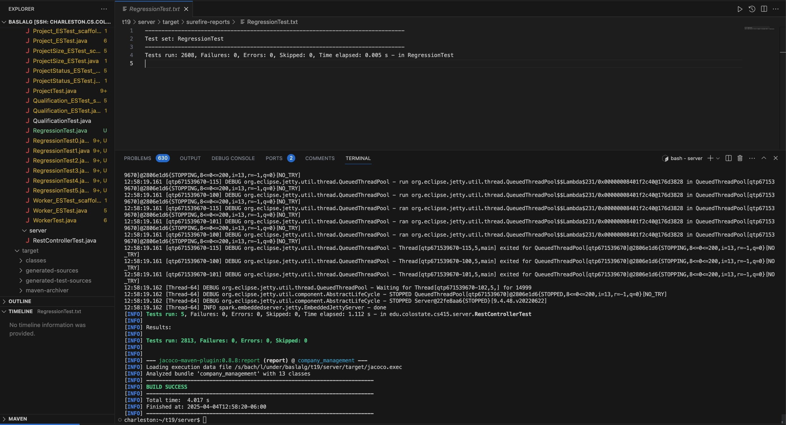

# P2 Evosuite and Randoop Reports

## Before Evosuite Was Run (NO Tests Generated)

  
*Figure 1: Evosuite Before Running/Generating Tests.*

## Evosuite Tests After Generating Tests
  
*Figure 2: Evosuite After Running/Generating Tests.*

## Proof that Maven Ran (No Errors)
  
*Figure 3: Maven Runs.*

*Figure 1: Screenshot showing that the generated Randoop tests were successfully executed using Maven without any failures.*

*Below is a portion of the Randoop log output, showing successful test generation for 4 classes, with 2608 regression tests created and no invalid or error-revealing tests detected. *

Randoop for Java version "4.3.2, local changes, branch master, commit df17bc8, 2023-01-08".

Will try to generate tests for 4 classes.
PUBLIC MEMBERS=61
Explorer = ForwardGenerator(steps: 0, null steps: 0, num_sequences_generated: 0;
    allSequences: 0, regresson seqs: 0, error seqs: 0=0=0, invalid seqs: 0, subsumed_sequences: 0, num_failed_output_test: 0;
    sideEffectFreeMethods: 1115, runtimePrimitivesSeen: 38)

Progress update: steps=1, test inputs generated=0, failing inputs=0      (2025-04-04T04:43:33.664927Z     33.1M used)
Progress update: steps=1000, test inputs generated=642, failing inputs=0      (2025-04-04T04:43:42.093148Z     43.9M used)
Progress update: steps=2000, test inputs generated=1288, failing inputs=0      (2025-04-04T04:43:49.721414Z     260M used)
Progress update: steps=3000, test inputs generated=1922, failing inputs=0      (2025-04-04T04:43:57.523489Z     421M used)
Progress update: steps=4000, test inputs generated=2561, failing inputs=0      (2025-04-04T04:44:05.443635Z     264M used)
Progress update: steps=5000, test inputs generated=3180, failing inputs=0      (2025-04-04T04:44:13.172101Z     95.2M used)
Progress update: steps=6000, test inputs generated=3804, failing inputs=0      (2025-04-04T04:44:20.992478Z     187M used)
Progress update: steps=7000, test inputs generated=4422, failing inputs=0      (2025-04-04T04:44:28.824557Z     227M used)
Progress update: steps=7631, test inputs generated=4810, failing inputs=0      (2025-04-04T04:44:33.666616Z     416M used)
Normal method executions: 13922624
Exceptional method executions: 909

Average method execution time (normal termination):      3.94e-05
Average method execution time (exceptional termination): 0.0214
Approximate memory usage 416M
Explorer = ForwardGenerator(steps: 7631, null steps: 2821, num_sequences_generated: 4810;
    allSequences: 4810, regresson seqs: 4809, error seqs: 0=0=0, invalid seqs: 0, subsumed_sequences: 0, num_failed_output_test: 1;
    sideEffectFreeMethods: 1115, runtimePrimitivesSeen: 58)

No error-revealing tests to output.

About to look for failing assertions in 2608 regression sequences.

Regression test output:
Regression test count: 2608
Writing regression JUnit tests...

                                                                                                                                                                                                       
Created file /s/bach/l/under/baslalg/t19/server/RegressionTest0.java
Created file /s/bach/l/under/baslalg/t19/server/RegressionTest1.java
Created file /s/bach/l/under/baslalg/t19/server/RegressionTest2.java
Created file /s/bach/l/under/baslalg/t19/server/RegressionTest3.java
Created file /s/bach/l/under/baslalg/t19/server/RegressionTest4.java
Created file /s/bach/l/under/baslalg/t19/server/RegressionTest5.java
Created file /s/bach/l/under/baslalg/t19/server/RegressionTest.java
Wrote regression JUnit tests.
About to look for flaky methods.

Invalid tests generated: 0

