# P2 PMD and SpotBugs Reports

## PMD Reports Before Refactoring

### File-Level Violations
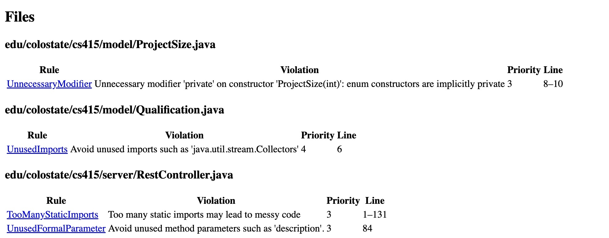  
*Figure 1: PMD violations shown per file before refactoring.*

### Violations by Priority
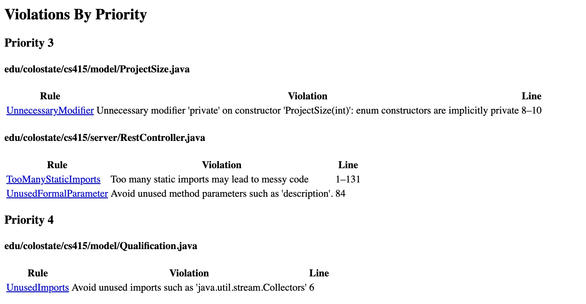  
*Figure 2: PMD violations by priority before refactoring.*

#### PMD Reports After Refactoring

*Figure 3: remaining violations after refactoring. These violations are related to unfinished or un-editiable code. Will Add one more image after the RestController.java class is implemented.*
---

## SpotBugs Reports Before Refactoring

### Summary
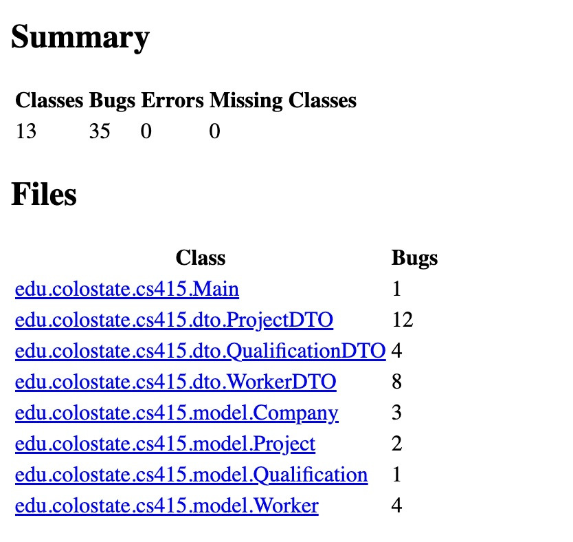  
*Figure 4: SpotBugs summary before refactoring.*

### Company.java
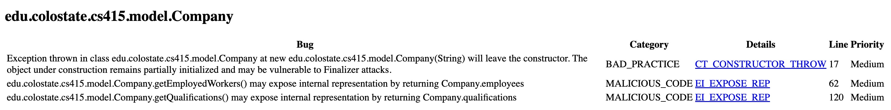  
*Figure 5: SpotBugs issues in Company.java before refactoring.*

### Main.java
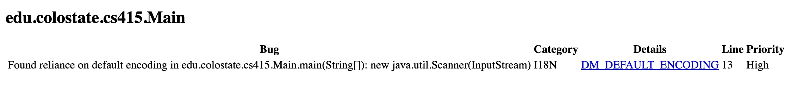  
*Figure 6: SpotBugs issues in Main.java before refactoring.*

### Project.java
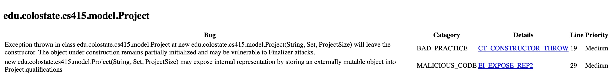  
*Figure 7: SpotBugs issues in Project.java before refactoring.*

### ProjectDTO.java
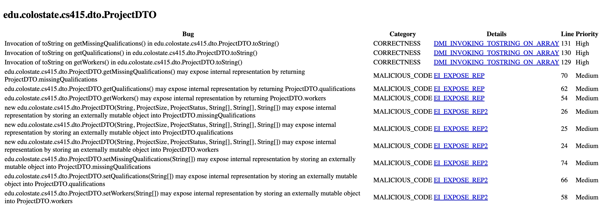  
*Figure 8: SpotBugs issues in ProjectDTO.java before refactoring.*

### Qualification.java
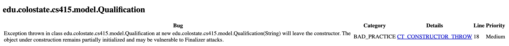  
*Figure 9: SpotBugs issues in Qualification.java before refactoring.*

### Worker.java
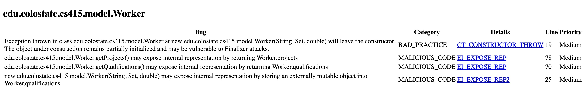  
*Figure 10: SpotBugs issues in Worker.java before refactoring.*

### WorkerDTO.java
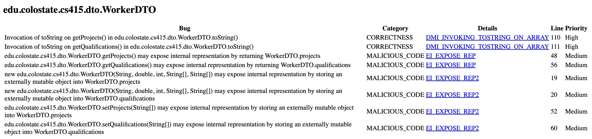  
*Figure 11: SpotBugs issues in WorkerDTO.java before refactoring.*

### RestController.java
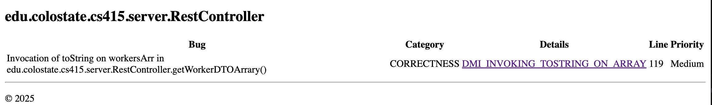
*Figure 11: SpotBugs issues in RestController.java before refactoring.*

### RestController.java
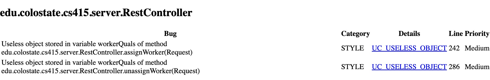
*Figure 12: Additional SpotBugs issues in RestController.java before refactoring.*

## SpotBugs Reports After Refactoring
## SpotBugs Reports After Refactoring
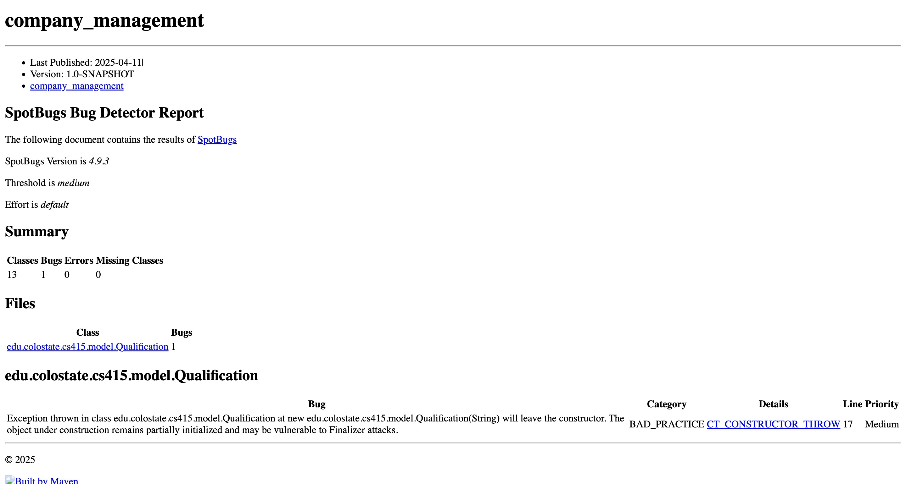
*Figure 13: SpotBugs report after refactoring*

## Unresolved Issues

### SpotBugs: CT_CONSTRUCTOR_THROW in Qualification
SpotBugs reported a `CT_CONSTRUCTOR_THROW` warning in the `Qualification` class, where an `IllegalArgumentException` is thrown if the input description is null or empty. While this issue could typically be resolved by moving validation to a static factory method or suppressing the warning, assignment constraints prohibit adding new public methods or altering the public API. As a result, the warning is acknowledged but intentionally left unresolved to maintain compatibility with the provided grading framework.
